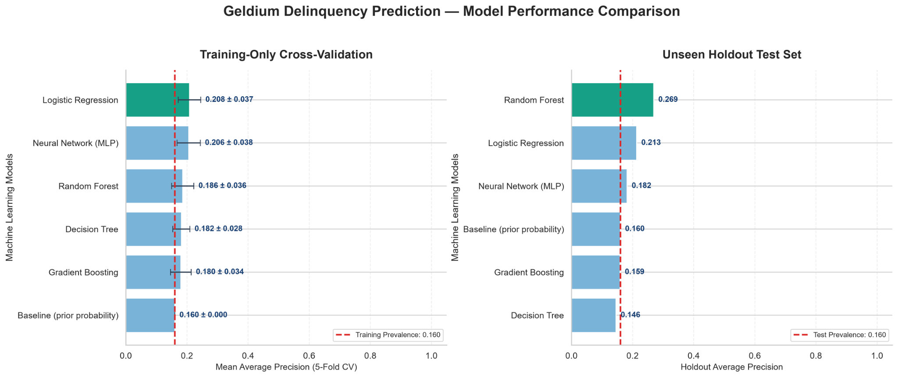
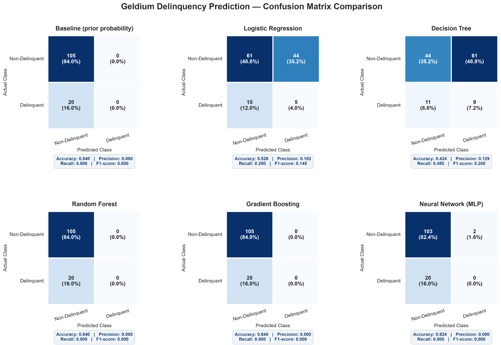
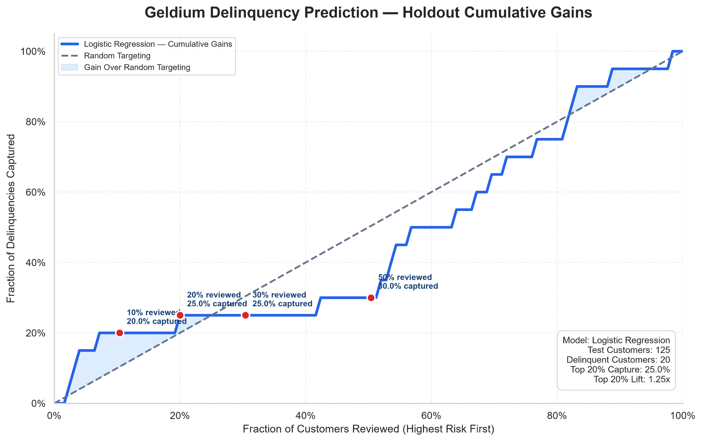
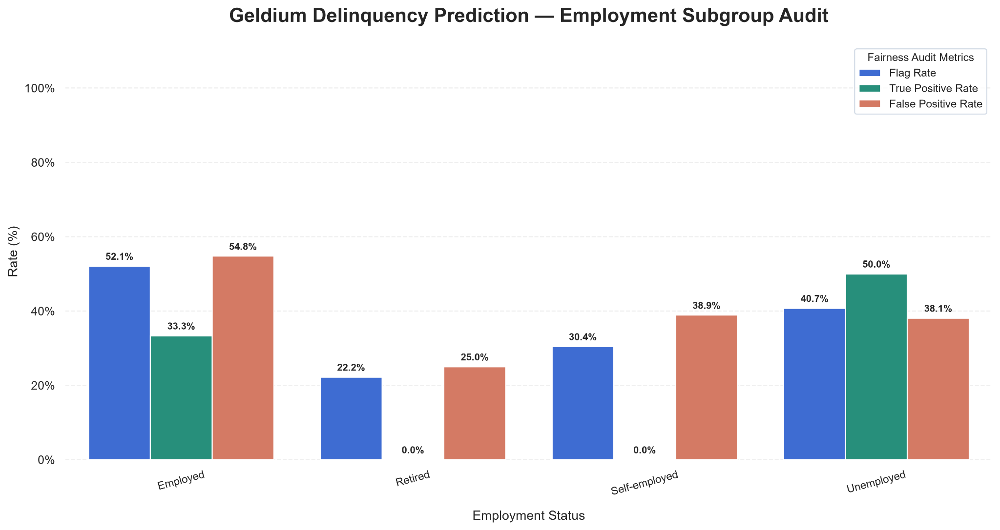

# Geldium | Delinquency Risk Analytics & Responsible AI

**End-to-end machine-learning case study** · Python · scikit-learn · EDA · Model Validation · Explainable AI · Collections Strategy

> **Portfolio disclaimer:** Geldium is a training case study, not a deployed lending or collections system. The results show weak predictive performance; no model here is approved for automated customer decisions.

## Executive summary

This project explores whether customer account attributes and six months of payment history can predict delinquency. It combines exploratory analysis, five supervised classification algorithms, an uninformed baseline, visual diagnostics, fairness checks, and a stakeholder-focused collections recommendation.

**Dataset:** 500 customer records; 80 delinquent accounts (16%). A stratified 25% holdout has 125 customers, including 20 delinquent accounts.

### Results at a glance

| Model | 5-fold CV average precision | Holdout average precision | Holdout ROC-AUC |
|---|---:|---:|---:|
| Baseline (prior probability) | 0.160 | 0.160 | 0.500 |
| Logistic Regression | **0.208** | 0.213 | 0.457 |
| Decision Tree | 0.182 | 0.146 | 0.446 |
| Random Forest | 0.186 | 0.244 | 0.400 |
| Gradient Boosting | 0.177 | 0.186 | 0.411 |
| Neural Network (MLP) | 0.206 | 0.182 | 0.443 |

*Numbers above are from the saved model-results CSV. Some supplied visualization labels differ (e.g. Random Forest holdout AP 0.269 in one figure vs. 0.244 in the CSV). Figures are archived for transparency; rerun and reconcile before citing a definitive value.*

**Conclusion:** Logistic Regression had the highest cross-validated average precision, but no model convincingly outperformed a random ranking on holdout ROC-AUC. The recommended next step is a **human-reviewed, six-week supportive outreach pilot**, not automated credit-risk scoring.

## Visual evidence









All ten figures are in [`assets/figures/`](assets/figures/).

## Repository layout

```text
notebooks/
  01_model_training_and_validation.ipynb
  02_responsible_ai_and_genai.ipynb
assets/figures/         # ten evaluation visualizations
reports/                # EDA, technical model report, Task 3 collections brief
results/                # saved aggregate model metrics (customer-level scores excluded)
data/                   # place the workbook locally (not tracked)
docs/METHODOLOGY.md
requirements.txt
```

## Run locally

```bash
python -m venv .venv
# macOS / Linux
source .venv/bin/activate
# Windows PowerShell: .venv\Scripts\Activate.ps1
pip install -r requirements.txt
jupyter notebook
```

1. Place `Delinquency_prediction_dataset.xlsx` in `data/`. The workbook is **not included** in the repository.
2. Open `notebooks/01_model_training_and_validation.ipynb` and select **Restart & Run All**.
3. The notebook writes CSV outputs and generated figures relative to its active working directory. Compare newly generated files with the archived assets; results may vary across environments.
4. Read the Task 3 brief in `reports/` for stakeholder recommendations.

## Responsible AI and limitations

- The target class is imbalanced (16% positive); accuracy alone is misleading.
- Only 20 positive cases are in the holdout; subgroup rates and feature rankings are unstable.
- Employment and location can raise fairness/proxy-bias concerns; the subgroup audit is **exploratory, not proof of fairness**.
- A 0.50 decision threshold is illustrative, not validated for collections operations.
- Verify chronology of monthly status features and the target before making predictive claims.
- Use consent-aware, non-punitive customer support; never automatically reduce credit access or escalate collections based on these scores.
- Customer-level risk scores are intentionally excluded from the public-ready package; regenerate locally and review privacy before sharing.

## Business recommendation

Pilot six weeks of supportive payment reminders and optional assistance, with human oversight, a defined control group, and measurements of engagement, 30+ day delinquency, complaints, and disparate impact. Treat improvement targets as hypotheses rather than achieved results.

## Acknowledgments

Prepared as an independent portfolio project based on the Tata iQ / Forage GenAI-powered data analytics simulation. **Not affiliated with or endorsed by Tata iQ, Forage, or a real financial institution.**

## License

MIT for original code and repository documentation; any third-party source data and training materials remain subject to their own terms.
